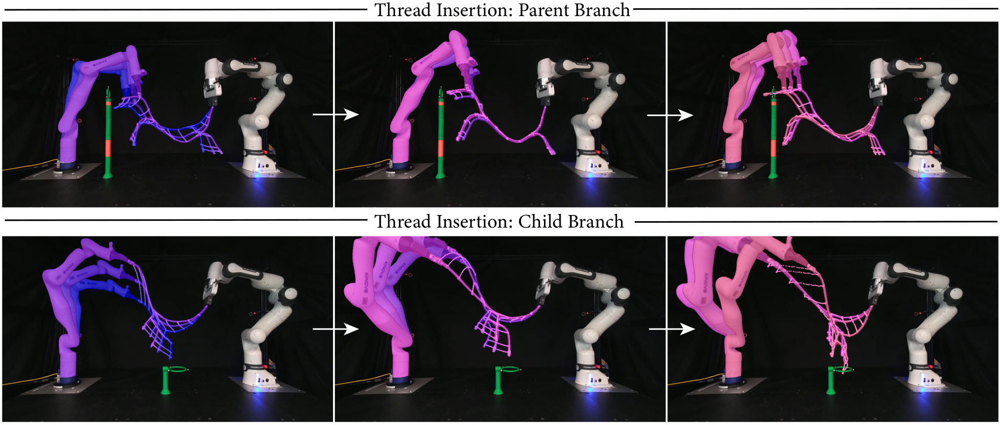

# DEFT: Differentiable Branched Discrete Elastic Rods for Modeling Furcated DLOs in Real-Time

**Accepted to The International Journal of Robotics Research (IJRR), 2026.**

[Project page](https://roahmlab.github.io/DEFT/) · [Paper (arXiv)](https://arxiv.org/abs/2502.15037) · [Video](https://www.youtube.com/watch?v=mwT6pzcyO2E)

This repository contains the source code and dataset for the paper DEFT: Differentiable Branched Discrete Elastic Rods for Modeling Furcated DLOs in Real-Time.

**Authors:** Yizhou Chen (yizhouch@umich.edu), Felicia Sang\* (fsang@umich.edu), Shicheng Peng\* (shchpeng@umich.edu), Xiaoyue Wu\* (wxyluna@umich.edu), Yeheng Zong (yehengz@umich.edu), Yuzhen Chen (yuzhench@umich.edu), Anran Li (anranli@umich.edu), Bohao Zhang (jimzhang@umich.edu), and Ramanarayan Vasudevan (ramv@umich.edu).
\* These authors contributed equally.

All authors are affiliated with the Department of Robotics, University of Michigan, 2505 Hayward Street, Ann Arbor, Michigan, USA.

## Introduction
<p align="center">
  
</p>

DEFT can be used with a motion planner to manipulate branched cables autonomously. **Top:** inserting the tip of the parent branch into a target hole. **Bottom:** inserting the tip of a child branch, in a BDLO with a different topology, while only the parent branch is grasped. DEFT predicts the state of the wire recursively throughout, without ground-truth or perception data at any stage.

**Abstract:** Autonomous wire harness assembly requires robots to manipulate complex branched cables with high precision and reliability. A key challenge is accurately predicting how branched cables deform during manipulation. Although well studied for single Deformable Linear Objects (DLOs), existing methods do not extend directly to Branched DLOs (BDLOs), whose junctions couple bending, twisting, and stretching across branches in ways that connecting multiple DLO models cannot capture. DEFT (Differentiable discrete branched Elastic rods for modeling Furcated DLOs in real-Time) combines a differentiable physics-based model with learning to 1) accurately model BDLO dynamics, including dynamic propagation at junctions and grasping in the middle of a BDLO, 2) achieve real-time inference, and 3) support planning for dexterous BDLO manipulation. DEFT introduces momentum-conserving junction constraints to capture cross-branch coupling, combines analytical gradients with branch-parallel computation for efficient parameter learning and inference, and uses a residual Graph Neural Network to reduce errors accumulated during long-horizon predictions. On six physical BDLOs with different topologies and material properties, the same formulation and residual-GNN architecture are applied without redesign. Over five-second recursive open-loop predictions, DEFT achieves RMSEs of 0.93–2.14 cm while running at over 100 Hz, and in real-world planning it succeeds in 36/40 shape-matching, 40/40 parent-branch insertion, and 16/20 child-branch insertion trials. To the best of our knowledge, this is the first publicly available dataset and code for modeling BDLOs.

## Modeling Results Visualization
<p align="center">
  
</p>
<p align="center">
  
</p>
Visualization of the predicted trajectories using DEFT, a DEFT ablation that leaves out the constraint described in Theorem 3, and Tree-LSTM. 
The ground-truth initial position of the vertices are colored in blue, the ground-truth final position of the vertices are colored in pink, and the gradient between these two colors is used to denote the ground truth location over time. 
The predicted vertices are colored as green circles (DEFT), orange circles (DEFT ablation), and light red circles (Tree-LSTM), respectively.
A gradient is used for these predictions to depict the evolution of time, starting from dark and going to light.
Note that the ground truth is only provided at t=0 s. 
The prediction is performed recursively without requiring additional ground-truth data or perception inputs throughout the process.

## Dependencies
Key dependencies include:
- PyTorch (2.5.1+)
- NumPy
- Numba
- PyTorch3D
- Theseus-AI
- Matplotlib
- Pandas

## Installation
Install via the provided conda environment file:
```bash
git clone https://github.com/roahmlab/DEFT.git
cd DEFT
conda env create -f environment.yml
conda activate DEFT
```
The training/eval scripts add the repo root to `sys.path` themselves, so no `pip install -e .` step is needed.

## Project Structure
```
DEFT/
├── deft/                   # Main package
│   ├── core/               # Core simulation modules
│   ├── models/             # Neural network models
│   ├── solvers/            # Constraint and theta solvers
│   └── utils/              # Utility functions
├── scripts/                # Training and analysis scripts
├── assets/                 # Images and media
├── dataset/                # Training and evaluation data
├── save_model/             # Saved model checkpoints
└── training_record/        # Training logs and records
```

## Train DEFT Models
The training entry point is `scripts/DEFT_train.py`. All arguments are keyword-only (parsed via `argparse`) and booleans expect the literal strings `true` / `false`.

**Run from the `scripts/` directory** — all dataset / checkpoint / log paths are relative to it (`../dataset/...`, `../save_model/...`, `../training_record/...`).

### Quick start
Train the physics-only BDLO1 model with end-grasping (default config):
```bash
cd scripts
python3 DEFT_train.py --BDLO_type 1 --clamp_type ends
```

Load the released pretrained full model and fine-tune only the GNN residual (physics frozen):
```bash
cd scripts
python3 DEFT_train.py --BDLO_type 1 --load_model true --training_mode residual --residual_learning true
```

### Arguments

| Flag | Type | Default | Description |
| --- | --- | --- | --- |
| `--BDLO_type` | int (1–6) | 1 | Which BDLO dataset/topology to train on. |
| `--clamp_type` | `ends` / `middle` | `ends` | End-grasping vs. mid-grasping. `middle` is only available for BDLO 1 and 3. |
| `--training_mode` | `physics` / `residual` / `full` | `physics` | `physics` trains only material parameters; `residual` trains only the GNN residual with physics frozen (requires `--load_model true`); `full` trains both jointly. |
| `--residual_learning` | bool | `false` | Enable the GNN residual term (sets a non-zero learning weight). Pair with `--training_mode residual` or `full`. |
| `--load_model` | bool | `false` | Load the pretrained full checkpoint for the selected BDLO/clamp combo from `save_model/`. Required for `residual` / `full` training modes. |
| `--train_batch` | int | 32 | Training batch size. |
| `--total_time` | int | 500 | Total timesteps per dataset pkl. |
| `--train_time_horizon` | int | 50 | Number of timesteps simulated per training iteration. |
| `--use_orientation_constraints` | bool | `true` | Enable the junction orientation constraint (also gates the coplanar projection). Turn off for ablation. |
| `--use_attachment_constraints` | bool | `true` | Enable the parent↔child attachment constraint. Turn off for ablation. |
| `--inference_1_batch` | bool | `false` | Use the numba single-batch inference path during eval. Faster; produces numerically identical results to the torch path. |
| `--inference_vis` | bool | `false` | Visualize eval rollouts during training (for debugging). |
| `--undeform_vis` | bool | `false` | Visualize the undeformed reference pose only, then exit. |

## Planning Tests
Three IPOPT-based planning scripts under `tests/` exercise the trained DEFT simulator on manipulation tasks. Run from the repo root with the `DEFT` environment activated:
```bash
cd DEFT
conda activate DEFT
```

### Shape matching (BDLO1)
```bash
python tests/shape_matching.py --sample_idx 0
python tests/shape_matching.py --full_batch
```

### Parent-branch thread insertion
```bash
python tests/parent_branch_thread_insertion.py --config 1 --height 1 --hole A
python tests/parent_branch_thread_insertion.py --config 2 --height 3 --hole B
```

### Child-branch thread insertion (BDLO5)
```bash
python tests/child_branch_thread_insertion.py --kinova 1 --franka 1 --target 1
python tests/child_branch_thread_insertion.py --kinova 2 --franka 1 --target 1
```

## Dataset
- For each BDLO, dynamic trajectory data is captured in real-world settings using a motion capture system operating at 100 Hz when robots grasp the BDLO’s ends. For details on dataset usage, please refer to DEFT_train.py.
- For BDLO 1 and BDLO 3, we record dynamic trajectory data when one robot grasps the middle of the BDLO while the other robot grasps one of its ends.

## Citation
If you use DEFT in an academic work, please cite:
```bibtex
@article{chen2026deft,
  title={DEFT: Differentiable Branched Discrete Elastic Rods for Modeling Furcated DLOs in Real-Time},
  author={Chen, Yizhou and Sang, Felicia and Peng, Shicheng and Wu, Xiaoyue and Zong, Yeheng and Chen, Yuzhen and Li, Anran and Zhang, Bohao and Vasudevan, Ramanarayan},
  journal={The International Journal of Robotics Research},
  year={2026},
  note={Accepted}
}
```

This project was developed in the [Robotics and Optimization for Analysis of Human Motion (ROAHM) Lab](http://www.roahmlab.com/) at the University of Michigan, Ann Arbor, with support from Ford Motor Company.
