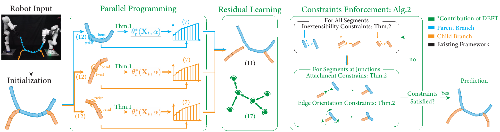
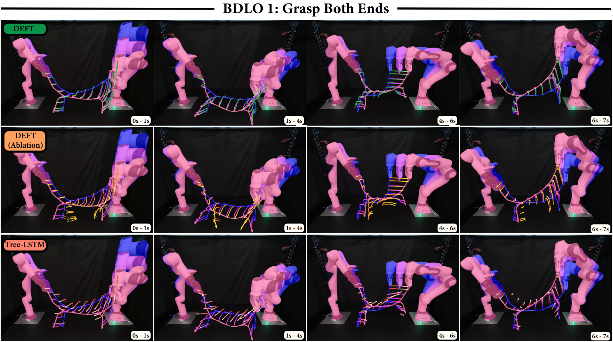
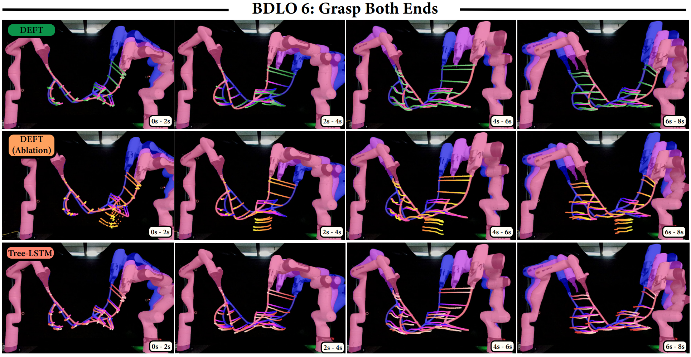
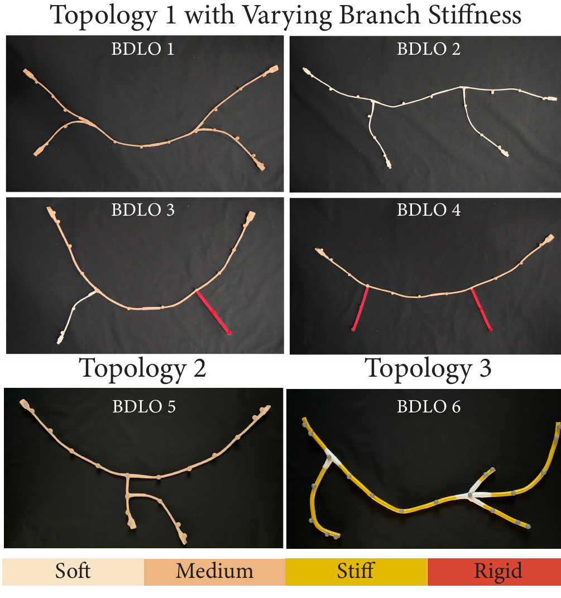

---
# Front matter. This is where you specify a lot of page variables.
layout: default
title:  "DEFT"
date:   2026-10-16 00:00:00 -0400
description: >- # Supports markdown
  **D**ifferentiable Branched Discrete **E**lastic Rods for Modeling **F**urcated DLOs in Real-**T**ime
show-description: true

# Add page-specific mathjax functionality. Manage global setting in _config.yml
mathjax: true
# Automatically add permalinks to all headings
# https://github.com/allejo/jekyll-anchor-headings
autoanchor: false

# Preview image for social media cards
image:
  path: https://roahmlab.github.io/DEFT/web_elements/title_page.png
  height: 100
  width: 256
  alt: DEFT thread insertion

authors:
  - name: Yizhou Chen
    email: yizhouch@umich.edu
  - name: Felicia Sang*
    email: fsang@umich.edu
  - name: Shicheng Peng*
    email: shchpeng@umich.edu
  - name: Xiaoyue Wu*
    email: wxyluna@umich.edu
  - name: Yeheng Zong
    email: yehengz@umich.edu
  - name: Yuzhen Chen
    email: yuzhench@umich.edu
  - name: Anran Li
    email: anranli@umich.edu
  - name: Bohao Zhang
    email: jimzhang@umich.edu
  - name: Ramanarayan Vasudevan
    email: ramv@umich.edu

author-footnotes: "* Equal contribution. All authors are affiliated with the Department of Robotics of the University of Michigan, Ann Arbor."

links:
  - icon: arxiv
    icon-library: simpleicons
    text: Arxiv
    url: https://arxiv.org/abs/2502.15037
  - icon: github
    icon-library: simpleicons
    text: Code
    url: https://github.com/roahmlab/DEFT
  - icon: youtube
    icon-library: simpleicons
    text: Video
    url: https://www.youtube.com/watch?v=mwT6pzcyO2E

# End Front Matter
---




---

# Abstract

Autonomous wire harness assembly requires robots to manipulate complex branched cables with high precision and reliability.
A key challenge to automating this process is accurately predicting how branched cables deform during manipulation.
Although well-studied for single Deformable Linear Objects (DLOs), existing methods do not extend directly to Branched DLOs (BDLOs), whose junctions couple bending, twisting, and stretching across branches in ways that connecting multiple DLO models cannot capture.
To address this challenge, this paper introduces Differentiable discrete branched Elastic rods for modeling Furcated DLOs in real-Time (DEFT), a framework that combines a differentiable physics-based model with learning to: 1) accurately model BDLO dynamics, including dynamic propagation at junctions and grasping in the middle of a BDLO, 2) achieve real-time inference, and 3) support planning for dexterous BDLO manipulation.
DEFT introduces momentum-conserving junction constraints to explicitly capture cross-branch coupling, combines analytical gradients with branch-parallel computation for efficient parameter learning and inference, and uses a residual Graph Neural Network to reduce errors accumulated during long-horizon predictions.
Experiments on six physical BDLOs with different topologies and material properties demonstrate formulation-level generalization: the same DEFT formulation and residual-GNN architecture are applied across all evaluated BDLOs without redesign, while the physical and learned parameters are fitted separately for each BDLO.
DEFT outperforms state-of-the-art physics-based and learning-based methods.
Over five-second recursive open-loop predictions, DEFT achieves RMSEs of 0.93–2.14 cm across the evaluated BDLOs while supporting real-time inference at over 100 Hz.
In real-world planning, DEFT achieves success rates of 36/40 for shape matching, 40/40 for parent-branch insertion, and 16/20 for child-branch insertion.

<p align="center">
  
</p>
DEFT used with a motion planner to manipulate BDLOs autonomously. Top: inserting the tip of the parent branch into a target hole. Bottom: inserting the tip of a child branch, in a BDLO with a different topology, while only the parent branch is grasped. DEFT predicts the state of the wire recursively throughout, without ground-truth or perception data at any stage.

---

# Method
<div markdown="1" class="content-block grey justify no-pre">
DEFT decomposes a BDLO into a parent DLO and one or more child DLOs, each modeled as a differentiable discrete elastic rod.
The branches are simulated in parallel, with analytical gradients for the material-frame optimization, and a residual graph neural network compensates for numerical integration errors.
After integration, momentum-preserving constraints enforce inextensibility on every branch, attachment at the junctions, and near-rigid edge orientation across each junction, so that bending and twisting propagate from the parent to the child branches.
Every component is differentiable, so the physical parameters and the residual network are learned directly from real-world data.
Contributions of DEFT are highlighted in green.
<p align="center">
  
</p>
</div>

---

# Results
<div markdown="1" class="content-block grey justify no-pre">
Predicted trajectories of DEFT (green), a DEFT ablation without the junction orientation constraint (orange), and Tree-LSTM (light red).
The ground truth goes from blue (initial) to pink (final).
Only the initial state is given; every prediction is recursive, with no ground-truth or perception input during the rollout.
<p align="center">
  
</p>
<p align="center">
  
</p>

Five-second open-loop prediction error (RMSE, cm; grasping both ends):

| Method | BDLO 1 | BDLO 2 | BDLO 3 | BDLO 4 | BDLO 5 | BDLO 6 |
|---|---|---|---|---|---|---|
| GCN | 6.64 | 6.52 | 5.41 | 4.30 | 4.50 | 6.82 |
| Tree-LSTM | 5.32 | 4.45 | 2.50 | 2.82 | 5.06 | 4.96 |
| AdaptiGraph | 4.01 | 4.45 | 3.08 | 2.69 | 2.82 | 3.84 |
| DEFORM<sup>+</sup> | 4.57 | 7.51 | 5.04 | 4.38 | 3.33 | 5.78 |
| **DEFT** | **1.44** | **2.14** | **1.20** | **0.93** | **0.96** | **1.15** |

Real-world planning success:

| Method | Shape matching | Parent-branch insertion | Child-branch insertion |
|---|---|---|---|
| Tree-LSTM | 13/40 | 0/40 | 0/20 |
| DEFORM<sup>+</sup> | 0/40 | 38/40 | 2/20 |
| DEFT (ablation) | 0/40 | 38/40 | 2/20 |
| **DEFT** | **36/40** | **40/40** | **16/20** |

</div>

---

# Dataset
<div markdown="1" class="content-block grey justify no-pre">
Six BDLOs with three topologies and branch stiffness from soft to rigid.
Dynamic trajectories are recorded with a motion capture system at 100 Hz while two robots grasp both ends of the BDLO (all six BDLOs), and while one robot grasps an end and the other the middle (BDLOs 1 and 3).
For dataset usage, please refer to `scripts/DEFT_train.py` in the [code repository](https://github.com/roahmlab/DEFT).
<p align="center">
  
</p>
</div>

---

# Video
<div class="fullwidth" style="position:relative;padding-bottom:56.25%;height:0;overflow:hidden;">
<iframe src="https://www.youtube.com/embed/mwT6pzcyO2E" title="DEFT video" style="position:absolute;top:0;left:0;width:100%;height:100%;border:0;" allow="accelerometer; clipboard-write; encrypted-media; gyroscope; picture-in-picture; web-share" allowfullscreen></iframe>
</div>
<p align="center"><a href="https://www.youtube.com/watch?v=mwT6pzcyO2E">Watch on YouTube</a> · <a href="web_elements/DEFT_video.mp4">Download MP4</a></p>

<div markdown="1" class="content-block grey justify">

# [Citation](#citation)

This project was developed in the [Robotics and Optimization for Analysis of Human Motion (ROAHM) Lab](http://www.roahmlab.com/) at the University of Michigan, Ann Arbor, with support from Ford Motor Company.

```bibtex
@misc{chen2026deftdifferentiablebrancheddiscrete,
      title={DEFT: Differentiable Branched Discrete Elastic Rods for Modeling Furcated DLOs in Real-Time}, 
      author={Yizhou Chen and Felicia Sang and Shicheng Peng and Xiaoyue Wu and Yeheng Zong and Yuzhen Chen and Anran Li and Bohao Zhang and Ram Vasudevan},
      year={2026},
      eprint={2502.15037},
      archivePrefix={arXiv},
      primaryClass={cs.RO},
      doi={https://doi.org/10.1177/02783649261503499},
      url={https://arxiv.org/abs/2502.15037}, 
}
```
</div>

---
